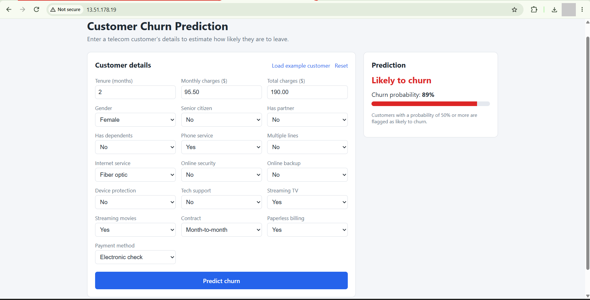
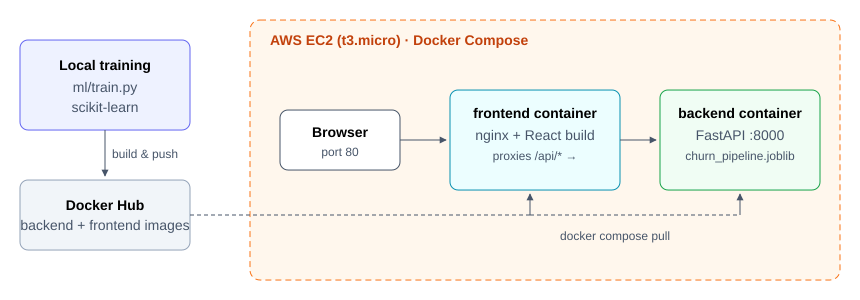
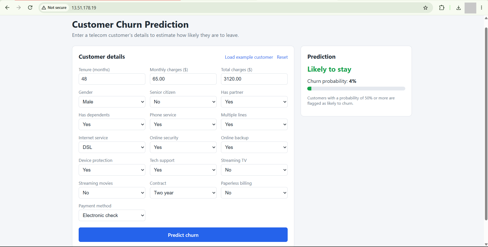
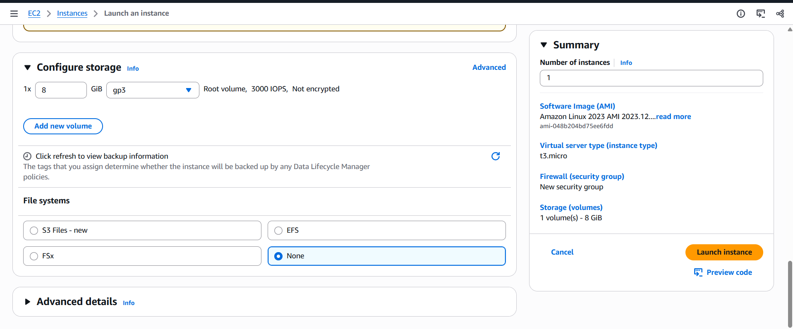
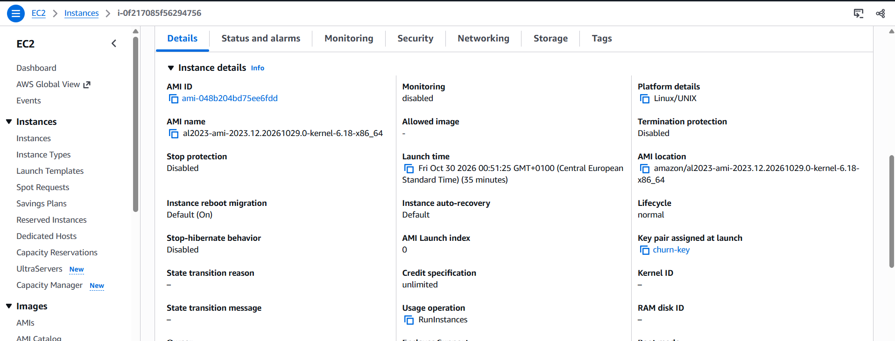
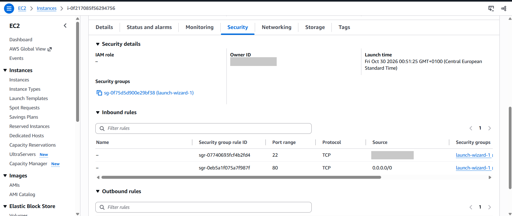
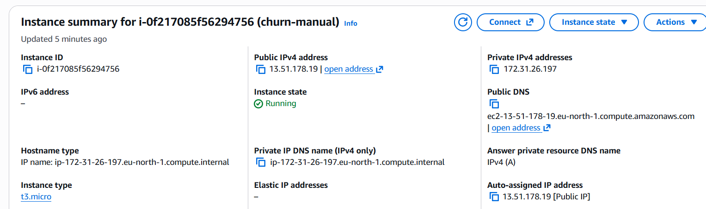
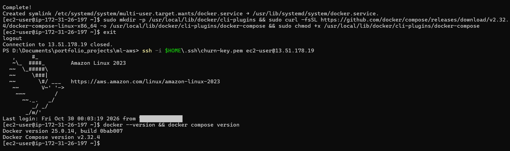
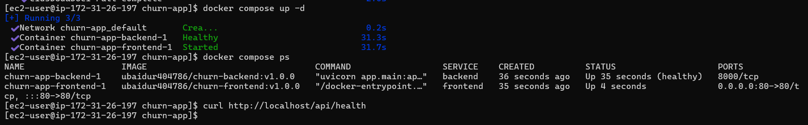
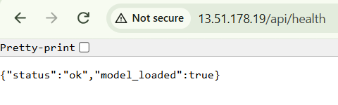

# Customer Churn Prediction — ML App on AWS with Docker & Terraform

A small end-to-end machine learning application that predicts whether a telecom customer is likely to leave (churn), served by FastAPI, used through a React web app, packaged with Docker, and deployed on AWS EC2.

**Dataset → scikit-learn model → FastAPI → React → Docker → Docker Hub → AWS EC2 → Terraform**

<p align="center">
  
</p>

## Architecture



- The browser talks only to **nginx on port 80** (frontend container).
- nginx serves the React app and forwards `/api/*` to the **FastAPI** container, which stays private.
- The trained scikit-learn pipeline is baked into the backend image and loaded once at startup.
- Both containers run with **Docker Compose** on a single EC2 instance. No database or load balancer is needed.

## Problem

Losing customers is expensive. If a company can spot customers who are likely to cancel, it can contact them with offers before they leave. This app takes a customer's account and service details and returns a churn prediction with a probability.

## Dataset

- **IBM Telco Customer Churn**: 7,043 customers, 21 columns, ~1 MB CSV
- Source: [IBM/telco-customer-churn-on-icp4d](https://github.com/IBM/telco-customer-churn-on-icp4d) (`data/Telco-Customer-Churn.csv`)
- License: Apache License 2.0
- The CSV is not committed. `ml/download_data.py` downloads it.

## Model

One scikit-learn `Pipeline` holds both the preprocessing (median imputation and scaling for numeric fields, one-hot encoding for categorical fields) and the model. The backend loads this single file, so predictions go through exactly the same transformations as training.

Two models were compared on a stratified 80/20 split. Logistic Regression was selected: its ROC-AUC equals the Random Forest's, and it is the simpler model.

| Model | Accuracy | Precision | Recall | F1 | ROC-AUC |
|---|---|---|---|---|---|
| **Logistic Regression** (selected) | 0.738 | 0.504 | 0.783 | 0.614 | 0.841 |
| Random Forest | 0.767 | 0.543 | 0.762 | 0.634 | 0.841 |

Both models use `class_weight="balanced"` because only 26.5% of customers churn, so recall on churners is high. Full results are in [ml/reports/metrics.json](ml/reports/metrics.json).

## Tech stack

Python 3.12 · pandas · scikit-learn · FastAPI · React 18 + Vite · nginx · Docker / Docker Compose · Docker Hub · AWS EC2 · Terraform

## Project structure

```
ml-aws/
├── ml/                 # download data, train + evaluate model
├── backend/            # FastAPI API + trained model + tests + Dockerfile
├── frontend/           # React app + nginx config + Dockerfile
├── terraform/          # EC2 + security group as code
├── docs/               # architecture diagram, deployment guide, screenshots
└── docker-compose.yml  # runs frontend + backend together
```

## Screenshots

### Application

<table>
  <tr>
    <td width="50%" valign="top">
      <br>
      <b>High-risk customer</b><br>
      New month-to-month fiber customer paying by electronic check: <i>Likely to churn, 89%</i>.
    </td>
    <td width="50%" valign="top">
      <br>
      <b>Low-risk customer</b><br>
      Long-term two-year contract customer: <i>Likely to stay, 4%</i>.
    </td>
  </tr>
</table>

### Manual AWS deployment

<table>
  <tr>
    <td width="50%" valign="top">
      <br>
      <b>1. Launch the instance</b><br>
      Amazon Linux 2023, <code>t3.micro</code>, 8 GiB gp3, new security group.
    </td>
    <td width="50%" valign="top">
      <br>
      <b>2. Instance details</b><br>
      AMI, platform and key pair of the running instance.
    </td>
  </tr>
  <tr>
    <td valign="top">
      <br>
      <b>3. Security group</b><br>
      SSH (22) only from my IP, HTTP (80) from anywhere. Port 8000 stays closed.
    </td>
    <td valign="top">
      <br>
      <b>4. Running instance and public IP</b><br>
      The public IPv4 address is used to open the app.
    </td>
  </tr>
  <tr>
    <td valign="top">
      <br>
      <b>5. Docker installed</b><br>
      Docker and the Compose plugin installed over SSH.
    </td>
    <td valign="top">
      <br>
      <b>6. Containers running</b><br>
      Images pulled from Docker Hub; backend healthy, frontend on port 80.
    </td>
  </tr>
  <tr>
    <td valign="top">
      <br>
      <b>7. Live application</b><br>
      The web app served from the EC2 public IP.
    </td>
    <td valign="top">
      <br>
      <b>8. API health check</b><br>
      <code>/api/health</code> confirms the model is loaded.
    </td>
  </tr>
</table>

## How to run

Prerequisites: Python 3.12, Node.js 20+, Docker Desktop. Commands are shown for Windows PowerShell; on Linux/macOS use `source .venv/bin/activate` instead of `.venv\Scripts\activate`.

### 1. Train the model

```bash
cd ml
python -m venv .venv
.venv\Scripts\activate
pip install -r requirements.txt
python download_data.py
python train.py                 # saves backend/model/churn_pipeline.joblib
cd ..
```

### 2. Run the backend (FastAPI)

```bash
cd backend
python -m venv .venv
.venv\Scripts\activate
pip install -r requirements-dev.txt
pytest                          # 3 tests
uvicorn app.main:app --reload --port 8000
```

API docs: http://localhost:8000/docs

### 3. Run the frontend (React) in a second terminal

```bash
cd frontend
npm install
npm run dev
```

Open http://localhost:5173. Vite forwards `/api` requests to the backend.

### 4. Run everything with Docker

```bash
docker compose up --build       # app on http://localhost (set APP_PORT=8080 in .env if port 80 is busy)
docker compose down
```

### 5. Push the images to Docker Hub

EC2 `t3.micro` is x86, so build for `linux/amd64`:

```bash
docker login
docker buildx build --platform linux/amd64 -t <DOCKERHUB_USERNAME>/churn-backend:v1.0.0 --push ./backend
docker buildx build --platform linux/amd64 -t <DOCKERHUB_USERNAME>/churn-frontend:v1.0.0 --push ./frontend
```

### 6. Deploy on AWS EC2 (manual)

Full step-by-step guide: **[docs/aws-manual-deployment.md](docs/aws-manual-deployment.md)**. In short:

1. Launch an Amazon Linux 2023 `t3.micro` instance with SSH (your IP) and HTTP (anywhere) allowed.
2. Connect: `ssh -i <KEY_FILE> ec2-user@<EC2_PUBLIC_IP>`
3. Install Docker and the Compose plugin.
4. Create `docker-compose.yml` that uses the Docker Hub images.
5. Start it:

```bash
docker compose pull
docker compose up -d
```

6. Open `http://<EC2_PUBLIC_IP>`.

### 7. Deploy with Terraform

_Coming next. The configuration is in [terraform/](terraform/)._

## API examples

```bash
curl http://<HOST>/api/health
# {"status":"ok","model_loaded":true}

curl -X POST http://<HOST>/api/predict -H "Content-Type: application/json" -d '{
  "gender":"Female","SeniorCitizen":0,"Partner":"No","Dependents":"No","tenure":2,
  "PhoneService":"Yes","MultipleLines":"No","InternetService":"Fiber optic",
  "OnlineSecurity":"No","OnlineBackup":"No","DeviceProtection":"No","TechSupport":"No",
  "StreamingTV":"Yes","StreamingMovies":"Yes","Contract":"Month-to-month",
  "PaperlessBilling":"Yes","PaymentMethod":"Electronic check",
  "MonthlyCharges":95.5,"TotalCharges":190}'
# {"churn":true,"churn_probability":0.8941,"label":"Likely to churn"}
```

Invalid input returns `422` with the list of invalid fields. `<HOST>` is `localhost` for Docker or the EC2 public IP.

## Cleanup (avoid extra cost)

If you deploy only for testing, delete the AWS resources when you are done. A running instance keeps using credits or money.

**AWS Console**

1. EC2 → **Instances** → select the instance → **Instance state** → **Terminate (delete) instance**.
2. EC2 → **Security Groups** → delete the group created for the instance.
3. EC2 → **Key Pairs** → delete the key pair.
4. Check that **Elastic IPs** and **Volumes** are empty, and review **Billing → Bills**.

**AWS CLI**

```bash
aws ec2 terminate-instances --instance-ids <INSTANCE_ID> --region <REGION>
aws ec2 wait instance-terminated --instance-ids <INSTANCE_ID> --region <REGION>
aws ec2 delete-security-group --group-name <SECURITY_GROUP_NAME> --region <REGION>
aws ec2 delete-key-pair --key-name <KEY_NAME> --region <REGION>
```

**Local Docker**

```bash
docker compose down --rmi all   # stop containers and remove the app images
```
