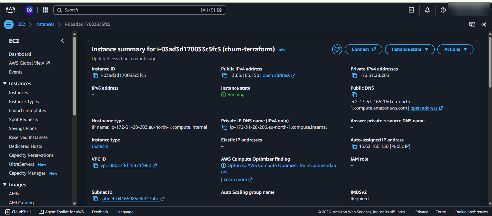
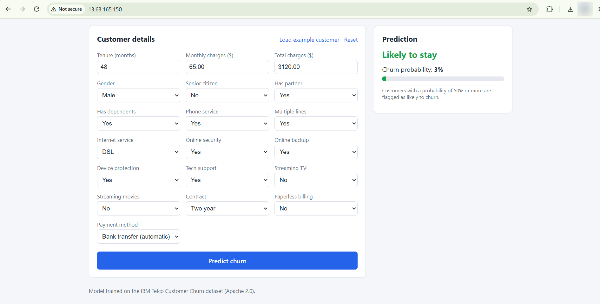

# Customer Churn Prediction — ML App on AWS with Docker & Terraform

Predicts whether a telecom customer is likely to leave (churn). Model served by FastAPI, used through a React app, packaged with Docker and deployed on AWS EC2, manually and with Terraform.

**Dataset → scikit-learn → FastAPI → React → Docker → Docker Hub → AWS EC2 → Terraform**

<p align="center">
  
</p>

## Architecture


The browser talks only to nginx on port 80. nginx serves the React app and forwards `/api/*` to the private FastAPI container, which loads the trained pipeline at startup. Both containers run with Docker Compose on one EC2 instance.

## Dataset and model

- **Data:** [IBM Telco Customer Churn](https://github.com/IBM/telco-customer-churn-on-icp4d), 7,043 customers, Apache 2.0. Downloaded by `ml/download_data.py`, not committed.
- **Model:** one scikit-learn `Pipeline` (imputation, scaling, one-hot encoding plus the classifier), so training and inference use identical preprocessing.

| Model | Accuracy | Precision | Recall | F1 | ROC-AUC |
|---|---|---|---|---|---|
| **Logistic Regression** (selected, simpler) | 0.738 | 0.504 | 0.783 | 0.614 | 0.841 |
| Random Forest | 0.767 | 0.543 | 0.762 | 0.634 | 0.841 |

**Tech stack:** Python 3.12 · scikit-learn · FastAPI · React 18 + Vite · nginx · Docker Compose · Docker Hub · AWS EC2 · Terraform

```
ml/         train + evaluate model        frontend/   React app + nginx
backend/    FastAPI + model + tests       terraform/  EC2 + security group as code
docs/       diagram, guides, screenshots  docker-compose.yml
```

## Application

<table>
  <tr>
    <td width="50%" valign="top">
      <br>
      <b>High-risk customer</b>: month-to-month fiber, electronic check, <i>89% churn</i>.
    </td>
    <td width="50%" valign="top">
      <br>
      <b>Low-risk customer</b>: two-year contract, <i>4% churn</i>.
    </td>
  </tr>
</table>

## Deployment 1: Manual EC2 (AWS Console)

📄 **Full steps, server commands and tests:** [docs/aws-manual-deployment.md](docs/aws-manual-deployment.md)

<table>
  <tr>
    <td width="50%" valign="top"><br><b>1. Launch</b>: Amazon Linux 2023, <code>t3.micro</code>, 8 GiB gp3.</td>
    <td width="50%" valign="top"><br><b>2. Security group</b>: SSH from my IP, HTTP 80 open, 8000 closed.</td>
  </tr>
  <tr>
    <td valign="top"><br><b>3. Docker installed</b> over SSH.</td>
    <td valign="top"><br><b>4. Containers running</b>: images pulled from Docker Hub.</td>
  </tr>
  <tr>
    <td valign="top"><br><b>5. Live app</b> on the EC2 public IP.</td>
    <td valign="top"><br><b>6. Health check</b>: model loaded.</td>
  </tr>
</table>

## Deployment 2: Terraform

📄 **Full steps:** [docs/aws-terraform-deployment.md](docs/aws-terraform-deployment.md). The server installs Docker and starts the app by itself through `user_data.sh`.

<table>
  <tr>
    <td width="50%" valign="top"><br><b>EC2 created by Terraform</b>: <code>churn-terraform</code>, running.</td>
    <td width="50%" valign="top"><br><b>Live app</b> with no manual server setup.</td>
  </tr>
</table>

## How to run

Prerequisites: Python 3.12, Node.js 20+, Docker Desktop. On Linux/macOS use `source .venv/bin/activate`.

```bash
# 1. Train the model (saves backend/model/churn_pipeline.joblib)
cd ml && python -m venv .venv && .venv\Scripts\activate
pip install -r requirements.txt && python download_data.py && python train.py && cd ..

# 2. Run everything locally with Docker → http://localhost
docker compose up --build

# 3. Push images to Docker Hub (EC2 t3.micro is x86)
docker login
docker buildx build --platform linux/amd64 -t <DOCKERHUB_USERNAME>/churn-backend:v1.0.0 --push ./backend
docker buildx build --platform linux/amd64 -t <DOCKERHUB_USERNAME>/churn-frontend:v1.0.0 --push ./frontend

# 4a. Deploy manually: follow docs/aws-manual-deployment.md
# 4b. Or deploy with Terraform
cd terraform
terraform init
terraform plan -out=tfplan
terraform apply tfplan
```

For development without Docker: `cd backend && pip install -r requirements-dev.txt && pytest && uvicorn app.main:app --reload`, then `cd frontend && npm install && npm run dev` (http://localhost:5173).

## API

```bash
curl http://<HOST>/api/health
# {"status":"ok","model_loaded":true}

curl -X POST http://<HOST>/api/predict -H "Content-Type: application/json" -d '{
  "gender":"Female","SeniorCitizen":0,"Partner":"No","Dependents":"No","tenure":2,
  "PhoneService":"Yes","MultipleLines":"No","InternetService":"Fiber optic",
  "OnlineSecurity":"No","OnlineBackup":"No","DeviceProtection":"No","TechSupport":"No",
  "StreamingTV":"Yes","StreamingMovies":"Yes","Contract":"Month-to-month",
  "PaperlessBilling":"Yes","PaymentMethod":"Electronic check",
  "MonthlyCharges":95.5,"TotalCharges":190}'
# {"churn":true,"churn_probability":0.8941,"label":"Likely to churn"}
```

Invalid input returns `422`. Interactive docs are at `/docs` when running the backend locally.

## Cleanup (avoid extra cost)

A running instance keeps using credits or money, so delete everything after testing.

```bash
# Terraform deployment
cd terraform && terraform destroy

# Manual deployment
aws ec2 terminate-instances --instance-ids <INSTANCE_ID> --region <REGION>
aws ec2 wait instance-terminated --instance-ids <INSTANCE_ID> --region <REGION>
aws ec2 delete-security-group --group-name <SECURITY_GROUP_NAME> --region <REGION>

# Key pair (both) and local Docker
aws ec2 delete-key-pair --key-name <KEY_NAME> --region <REGION>
docker compose down --rmi all
```

Finally, check that EC2 **Instances**, **Volumes** and **Elastic IPs** are empty and that **Billing → Bills** shows nothing unexpected.
