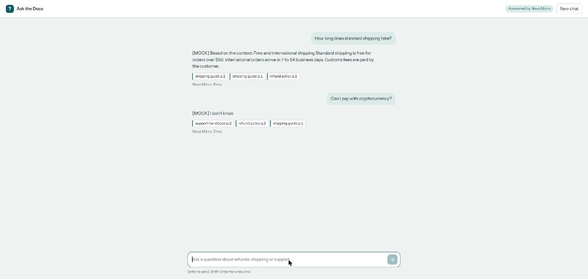
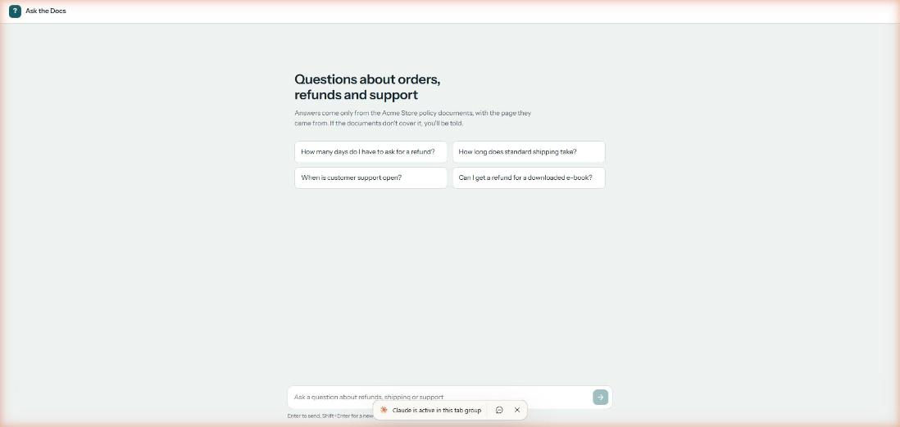
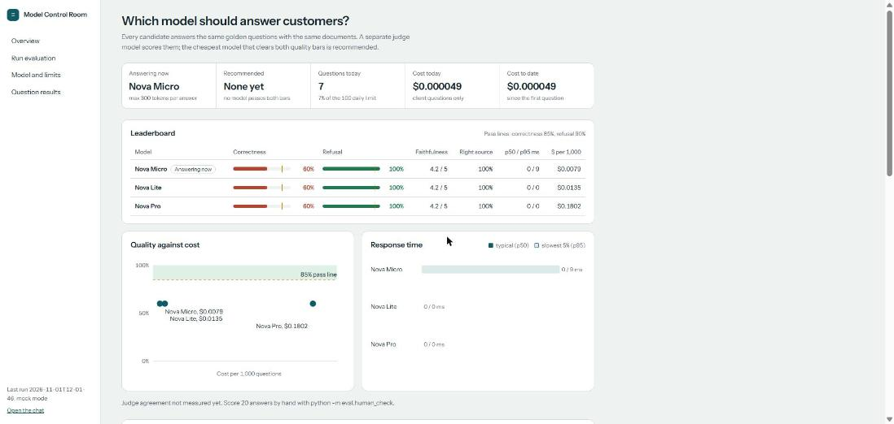
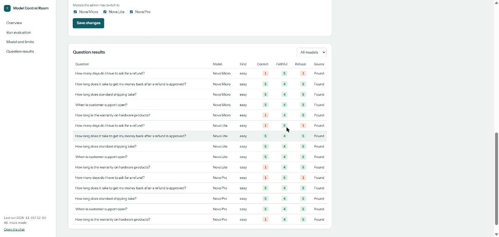
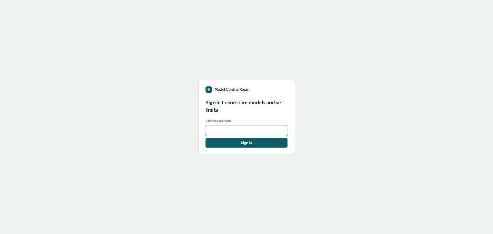
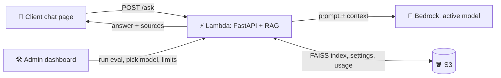
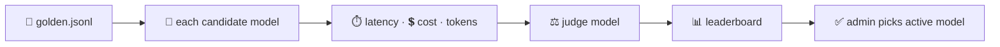

# 🧪 LLM Eval & Gateway on AWS

**Test several Amazon Bedrock LLMs on your own documents, pick the best value model from a dashboard, then serve it to users through a RAG chat app.**

> v2 of this repo. v1 (customer churn ML on EC2) is in the [repo root README](../README.md).

## 🚦 Project status

| # | Step | Status |
|---|---|---|
| 1 | Skeleton + mock mode | ✅ done |
| 2 | RAG (PDF → Titan → FAISS) + golden set | 🟡 works in mock mode; real Bedrock waits for AWS account access |
| 3 | Evaluation, LLM judge, report, human agreement | 🟡 works in mock mode |
| 4 | Admin dashboard + client chat (React) | 🟡 works in mock mode |
| 5 | Docker + Terraform deploy (Lambda, ECR, S3, budgets) | ⏳ next |
| 6 | GitHub Actions with eval gate | ⏳ planned |

> Every screenshot and number below comes from **mock mode** (`LLM_MODE=mock`): fake answers, free, no AWS. Real Bedrock results replace them once the account is authorized.

## 🖼️ Screenshots (mock mode)

**Client chat**: answers only from the documents, with the source page and the model that answered.



<details><summary>Empty chat with starter questions</summary>


</details>

**Admin dashboard**: leaderboard, quality vs cost, response time, settings and limits.



**Admin question results**: every judged answer with the judge's reason.



<details><summary>Admin sign-in</summary>


</details>

## ⏱️ How it works in 30 seconds

1. 📄 Your PDFs are split into chunks, embedded with Titan, and stored in a FAISS index.
2. 📝 A hand-checked **golden dataset** lists questions and their correct answers.
3. 🔁 Every candidate model answers every golden question with the **same RAG pipeline**. Latency, tokens and cost are recorded.
4. ⚖️ A separate **judge model** scores each answer for correctness, faithfulness and refusal.
5. 📊 The **admin dashboard** shows the leaderboard. The admin picks the active model and sets limits.
6. 💬 The **client chat** answers questions with the approved model and shows its sources.

## 🏗️ System design

```
┌─────────────┐     ┌──────────────────┐     ┌────────────────────┐
│ 👤 Client   │ ──▶ │ ⚡ Lambda /ask   │ ──▶ │ 🧠 Bedrock (model   │
│  chat page  │     │  FastAPI + RAG   │     │  chosen by admin)  │
└─────────────┘     └──────────────────┘     └────────────────────┘
       ▲                 │     ▲
       │                 ▼     │
       │          ┌───────────────┐     🛠️ Admin dashboard
       └───────── │ 🪣 S3: FAISS, │ ◀── run eval · pick model · limits
        answer +  │ golden, config│
        sources   └───────────────┘
```



### 🧭 The whole flow, end to end

```
 ① BUILD THE KNOWLEDGE (once, offline)
 📄 PDFs ──▶ ✂️ pypdf chunks ──▶ 🔢 Titan v2 embeddings (512-d) ──▶ 🗂️ FAISS index ──▶ 🪣 S3

 ② EVALUATE THE MODELS (admin, before go-live)
 📝 golden.jsonl ──▶ for each candidate model (Nova Micro / Lite / Pro):
        same RAG: top-k chunks ──▶ prompt "answer only from context, else I don't know"
        record answer · ⏱️ latency · 🔤 tokens · 💲 cost
   ──▶ ⚖️ judge model (NOT a candidate) scores 1-5: correctness · faithfulness · refusal
   ──▶ ✔️ simple checks (right source, length) + 👤 human check on 20 answers (agreement %)
   ──▶ 📊 report: leaderboard, p50/p95 latency, $/1000 questions, charts
   ──▶ ⭐ recommended = cheapest + fastest with correctness ≥ 85% and refusal ≥ 90%

 ③ ADMIN DECIDES (/admin, password)
 🛠️ dashboard ──▶ picks active model · allowed models · max_tokens · daily question limit
            ──▶ saved as settings.json in 🪣 S3

 ④ CLIENT ASKS (/)
 👤 question ──▶ ⚡ Lambda Function URL (FastAPI)
            ──▶ check daily limit (429 if reached)
            ──▶ 🔢 embed question ──▶ 🗂️ FAISS top-k ──▶ 🧠 Bedrock active model
            ──▶ 💬 answer + 📎 source pages + model name ──▶ usage + cost logged to 🪣 S3

 ⑤ SHIP CHANGES (GitHub Actions, OIDC, main only)
 🔀 push ──▶ 🧪 pytest ──▶ 🐳 build image ──▶ 📦 ECR ──▶ ⚡ update Lambda
        ──▶ 🚦 30-question eval gate: build FAILS if scores drop
```

**Where each piece runs on AWS**

| Piece | AWS service | Why |
|---|---|---|
| React chat + dashboard | S3 static website | Plain files, cents per month |
| FastAPI + RAG | Lambda (container image from ECR) + Function URL | Pay per request, no server, no load balancer |
| LLMs + embeddings | Bedrock (Nova models, Titan Text Embeddings v2) | Pay per token, no GPU |
| FAISS index, settings, eval results, usage | S3 (small files) | No database needed |
| Cost safety | AWS Budgets at $5 / $20 / $50 | Email alerts before costs grow |
| Infrastructure | Terraform (every resource tagged `Project=llm-eval-gateway`) | Create and destroy with one command |

Locally the same code runs with `uvicorn`, JSON files in `storage/` instead of S3, and `LLM_MODE=mock` for free testing.

### 🔁 Evaluation flow

```
📄 golden.jsonl → 🔁 each model → ⏱️ latency · 💲 cost → ⚖️ judge → 📊 leaderboard → ✅ admin picks
```



## 📝 Golden dataset

`data/golden.jsonl` has 10 sample rows (5 easy, 3 multi-step, 2 unanswerable). They are based on 3 small sample PDFs in `data/docs/` about a made-up shop. The PDFs were written for this project and are created by `scripts/make_sample_pdfs.py`.

```json
{"id": 3, "question": "How long does standard shipping take?", "expected_answer": "3 to 5 business days.", "source": "shipping_guide.pdf p.1", "type": "easy"}
```

To use your own PDFs, put them in `data/docs/` and run `python scripts/draft_golden.py`. It writes **drafts** to `data/golden_draft.jsonl`.
> ⚠️ **I review every row by hand** (question, expected answer, source, type) before copying it into `golden.jsonl`. The model's drafts are never used without that check.

## 📡 API examples

**POST /ask**
```json
// request
{"question": "What is the refund window?"}
// response
{
  "answer": "Refunds are accepted within 30 days of purchase with a receipt.",
  "sources": ["policy.pdf p.2"],
  "model": "amazon.nova-micro-v1:0",
  "mode": "bedrock",
  "latency_ms": 640,
  "input_tokens": 210,
  "output_tokens": 18
}
```

**POST /admin/eval**
```json
// request (header: X-Admin-Password)
{"models": ["amazon.nova-micro-v1:0", "amazon.nova-lite-v1:0"], "sample_size": 5}
// response
{
  "run_id": "2026-11-01T10-00-00",
  "results": [
    {"model": "amazon.nova-micro-v1:0", "correctness_pct": 88, "refusal_pct": 100, "p50_latency_ms": 610, "cost_per_1000_usd": 0.09},
    {"model": "amazon.nova-lite-v1:0",  "correctness_pct": 92, "refusal_pct": 100, "p50_latency_ms": 820, "cost_per_1000_usd": 0.21}
  ],
  "recommended": "amazon.nova-micro-v1:0"
}
```

## 🗂️ Folder map

| Folder | What it holds |
|---|---|
| `app/` | FastAPI backend: config, RAG retrieval, LLM calls |
| `data/` | `golden.jsonl` and `docs/` (sample PDFs) |
| `eval/` | Scripts that run models, judge answers, and build reports |
| `frontend/` | React (Vite) app with two pages: client chat and admin dashboard |
| `terraform/` | AWS infrastructure (S3, ECR, IAM, Lambda, budget), one file per concern *(Step 5)* |
| `tests/` | pytest tests (21 passing) |
| `storage/`, `index/` | Local JSON settings/usage/eval results and the FAISS index (git-ignored, created at run time) |
| `../.github/workflows/` | CI/CD with the evaluation gate *(Step 6)* |
| `scripts/` | Helpers: make sample PDFs, draft golden rows, ask golden questions |
| `docs/tutorial/` | Step-by-step build tutorial with commands, outputs and screenshots |

## 🚀 Step-by-step commands

**1. Setup (Windows PowerShell)**
```powershell
cd v2-llm-eval-gateway
python -m venv .venv
.venv\Scripts\Activate.ps1
pip install -r requirements.txt
copy .env.example .env
```
Linux/macOS: `source .venv/bin/activate` and `cp .env.example .env`.

**1b. Build the React frontend (needs Node.js 20+)**
```bash
cd frontend
```
```bash
npm install
```
```bash
npm run build
```
```bash
cd ..
```

**2. Run in mock mode (free, no AWS)**
```bash
uvicorn app.main:app --reload
```
```bash
curl -X POST http://localhost:8000/ask -H "Content-Type: application/json" -d "{\"question\": \"What is the refund window?\"}"
```

**3. Run tests**
```bash
pytest -q
```

**4. Run with real Bedrock** *(Step 2)*
```bash
# set LLM_MODE=bedrock in .env, then:
uvicorn app.main:app --reload
```

**5. Ingest documents** *(Step 2)*
```bash
python -m app.ingest
```

**6. Run evaluation** *(all models, then judge, then report)*
```bash
python -m eval.run_eval --sample 5
```

**7. Open dashboard** *(password = ADMIN_PASSWORD in .env)*
```
http://localhost:8000/admin
```

**8. Terraform init / plan / apply** *(Step 5)*
```bash
cd terraform
terraform init
terraform plan
terraform apply
```

**9. Deploy** *(Step 6: push to `main`, GitHub Actions deploys)*
```bash
git push origin main
```

**10. Terraform destroy**
```bash
terraform destroy
```

## 💲 What it costs

_Placeholder: filled in from real billing after deployment._

| Item | Expected cost |
|---|---|
| Bedrock calls (eval + chat) | TBD |
| Lambda | TBD |
| S3 + ECR storage | TBD |

## 📊 Results

_Placeholder: leaderboard and charts appear here after the first real evaluation run._

## 💡 What I learned

_Placeholder._
