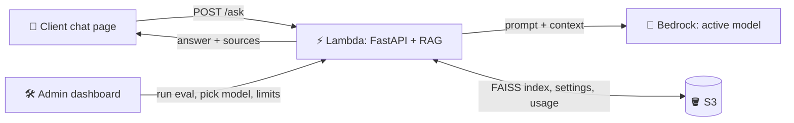
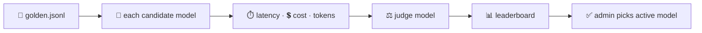

# 🧪 LLM Eval & Gateway on AWS

**Test several Amazon Bedrock LLMs on your own documents, pick the best value model from a dashboard, then serve it to users through a RAG chat app.**

> v2 of this repo. v1 (customer churn ML on EC2) is in the [repo root README](../README.md).

## ⏱️ How it works in 30 seconds

1. 📄 Your PDFs are split into chunks, embedded with Titan, and stored in a FAISS index.
2. 📝 A hand-checked **golden dataset** lists questions and their correct answers.
3. 🔁 Every candidate model answers every golden question with the **same RAG pipeline**. Latency, tokens and cost are recorded.
4. ⚖️ A separate **judge model** scores each answer for correctness, faithfulness and refusal.
5. 📊 The **admin dashboard** shows the leaderboard. The admin picks the active model and sets limits.
6. 💬 The **client chat** answers questions with the approved model and shows its sources.

## 🏗️ System design

```
┌─────────────┐     ┌──────────────────┐     ┌────────────────────┐
│ 👤 Client   │ ──▶ │ ⚡ Lambda /ask   │ ──▶ │ 🧠 Bedrock (model   │
│  chat page  │     │  FastAPI + RAG   │     │  chosen by admin)  │
└─────────────┘     └──────────────────┘     └────────────────────┘
       ▲                 │     ▲
       │                 ▼     │
       │          ┌───────────────┐     🛠️ Admin dashboard
       └───────── │ 🪣 S3: FAISS, │ ◀── run eval · pick model · limits
        answer +  │ golden, config│
        sources   └───────────────┘
```



### 🔁 Evaluation flow

```
📄 golden.jsonl → 🔁 each model → ⏱️ latency · 💲 cost → ⚖️ judge → 📊 leaderboard → ✅ admin picks
```



## 📝 Golden dataset

`data/golden.jsonl` has 10 sample rows (5 easy, 3 multi-step, 2 unanswerable). They are based on 3 small sample PDFs in `data/docs/` about a made-up shop. The PDFs were written for this project and are created by `scripts/make_sample_pdfs.py`.

```json
{"id": 3, "question": "How long does standard shipping take?", "expected_answer": "3 to 5 business days.", "source": "shipping_guide.pdf p.1", "type": "easy"}
```

To use your own PDFs, put them in `data/docs/` and run `python scripts/draft_golden.py`. It writes **drafts** to `data/golden_draft.jsonl`.
> ⚠️ **I review every row by hand** (question, expected answer, source, type) before copying it into `golden.jsonl`. The model's drafts are never used without that check.

## 📡 API examples

**POST /ask**
```json
// request
{"question": "What is the refund window?"}
// response
{
  "answer": "Refunds are accepted within 30 days of purchase with a receipt.",
  "sources": ["policy.pdf p.2"],
  "model": "amazon.nova-micro-v1:0",
  "mode": "bedrock",
  "latency_ms": 640,
  "input_tokens": 210,
  "output_tokens": 18
}
```

**POST /admin/eval** *(added in Step 4)*
```json
// request (header: X-Admin-Password)
{"models": ["amazon.nova-micro-v1:0", "amazon.nova-lite-v1:0"], "sample_size": 5}
// response
{
  "run_id": "2026-11-01T10-00-00",
  "results": [
    {"model": "amazon.nova-micro-v1:0", "correctness_pct": 88, "refusal_pct": 100, "p50_latency_ms": 610, "cost_per_1000_usd": 0.09},
    {"model": "amazon.nova-lite-v1:0",  "correctness_pct": 92, "refusal_pct": 100, "p50_latency_ms": 820, "cost_per_1000_usd": 0.21}
  ],
  "recommended": "amazon.nova-micro-v1:0"
}
```

## 🗂️ Folder map

| Folder | What it holds |
|---|---|
| `app/` | FastAPI backend: config, RAG retrieval, LLM calls |
| `data/` | `golden.jsonl` and `docs/` (sample PDFs) |
| `eval/` | Scripts that run models, judge answers, and build reports |
| `frontend/` | Two plain HTML pages: client chat and admin dashboard |
| `terraform/` | AWS infrastructure (S3, ECR, IAM, Lambda, budget), one file per concern |
| `tests/` | pytest tests |
| `.github/workflows/` | CI/CD with the evaluation gate |
| `scripts/` | Helpers: make sample PDFs, draft golden rows, ask golden questions |
| `docs/tutorial/` | Step-by-step build tutorial with commands, outputs and screenshots |

## 🚀 Step-by-step commands

**1. Setup (Windows PowerShell)**
```powershell
cd v2-llm-eval-gateway
python -m venv .venv
.venv\Scripts\Activate.ps1
pip install -r requirements.txt
copy .env.example .env
```
Linux/macOS: `source .venv/bin/activate` and `cp .env.example .env`.

**2. Run in mock mode (free, no AWS)**
```bash
uvicorn app.main:app --reload
```
```bash
curl -X POST http://localhost:8000/ask -H "Content-Type: application/json" -d "{\"question\": \"What is the refund window?\"}"
```

**3. Run tests**
```bash
pytest -q
```

**4. Run with real Bedrock** *(Step 2)*
```bash
# set LLM_MODE=bedrock in .env, then:
uvicorn app.main:app --reload
```

**5. Ingest documents** *(Step 2)*
```bash
python -m app.ingest
```

**6. Run evaluation** *(Step 3)*
```bash
python -m eval.run_models
```

**7. Open dashboard** *(Step 4)*
```
http://localhost:8000/admin
```

**8. Terraform init / plan / apply** *(Step 5)*
```bash
cd terraform
terraform init
terraform plan
terraform apply
```

**9. Deploy** *(Step 6: push to `main`, GitHub Actions deploys)*
```bash
git push origin main
```

**10. Terraform destroy**
```bash
terraform destroy
```

## 💲 What it costs

_Placeholder: filled in from real billing after deployment._

| Item | Expected cost |
|---|---|
| Bedrock calls (eval + chat) | TBD |
| Lambda | TBD |
| S3 + ECR storage | TBD |

## 📊 Results

_Placeholder: leaderboard and charts appear here after the first real evaluation run._

## 💡 What I learned

_Placeholder._
