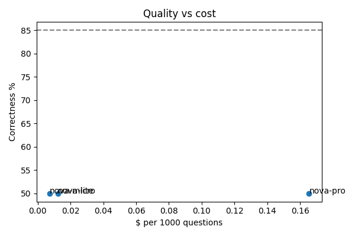
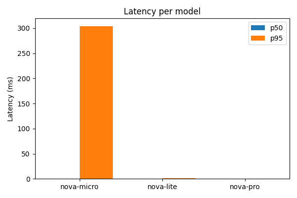

# Step 3: Evaluation scripts + report + judge agreement (mock mode)

**Goal:** ask every golden question to every candidate model with the same RAG pipeline, score the answers with a separate judge model, and build a leaderboard (CSV, Markdown, PNG charts).

> Built in **mock mode** because Bedrock is not yet authorized on the AWS account (see Step 2). Mock scores are not real quality numbers; they only prove the pipeline works. Real numbers come once Bedrock is open.

## What was created

| File | Purpose |
|---|---|
| `app/pricing.py` | Price per 1K tokens for each model, and `cost_usd()` |
| `eval/run_models.py` | Same RAG, only the model changes. Saves answer, latency_ms, tokens, cost_usd |
| `eval/judge.py` | LLM-as-judge with a rubric. Scores correctness, faithfulness, refusal from 1 to 5 as JSON. The judge (`amazon.nova-premier-v1:0`) is not a candidate; the code refuses to run if it is |
| `eval/checks.py` | Rule checks with no LLM: right source, answer length, "I don't know" detection |
| `eval/report.py` | Leaderboard, recommended model, CSV + Markdown + 2 PNG charts |
| `eval/human_check.py` | You score 20 answers by hand; prints judge-vs-human agreement % |
| `eval/run_eval.py` | All three steps in one call (used by the admin dashboard) |
| `tests/test_eval.py` | Tests for pricing, checks, judge parsing, percentiles, recommendation, agreement |

**Scoring rules**
- A judge score of 4 or 5 counts as a pass.
- Correctness % = passes on answerable questions (easy + multi).
- Refusal % = passes on unanswerable questions (the model must say "I don't know").
- **Recommended model** = the cheapest, then fastest, model with correctness ≥ 85% and refusal ≥ 90%.

## Commands

1. Install the new packages (matplotlib, python-dotenv):
```bash
pip install -r requirements.txt
```

2. Build the index:
```bash
python -m app.ingest
```

3. Ask all golden questions to all candidate models:
```bash
python -m eval.run_models
```
Output ([log](logs/step-03-run-models.txt)):
```
Saved 30 answers from 3 models (mock mode)
```

4. Judge the answers:
```bash
python -m eval.judge
```
Output ([log](logs/step-03-judge.txt)):
```
Judged 30 answers with amazon.nova-premier-v1:0 (mock mode)
```

5. Build the report:
```bash
python -m eval.report
```
Output ([log](logs/step-03-report.txt)):

| Model | Correctness | Faithfulness | Refusal | Right source | p50 ms | p95 ms | $ / 1000 questions |
|---|---|---|---|---|---|---|---|
| amazon.nova-micro-v1:0 | 50.0% | 4.4 | 100.0% | 100.0% | 0 | 304 | $0.0072 |
| amazon.nova-lite-v1:0 | 50.0% | 4.4 | 100.0% | 100.0% | 0 | 1 | $0.0124 |
| amazon.nova-pro-v1:0 | 50.0% | 4.4 | 100.0% | 100.0% | 0 | 0 | $0.1655 |

Recommended: **none** (mock answers are copied text, so no model reaches 85% correctness).
All mock models give the same answers, so only the cost differs. The 304 ms is the first call loading the index.

Charts (written to `eval/results/`, git-ignored):




6. Or run everything at once on a small sample:
```bash
python -m eval.run_eval --sample 5
```

7. Measure judge agreement (you type a 1-5 score for each of 20 answers):
```bash
python -m eval.human_check
```
_Not run yet: this needs your own scores. Do it after the first real Bedrock evaluation, since scoring mock answers says nothing about the real judge._

8. Run the tests:
```bash
pytest -q
```
Output: `21 passed`.

## Problems and fixes

| Problem | Fix |
|---|---|
| `.env` was not read: `config.py` only used real environment variables | Added `python-dotenv`; `config.py` calls `load_dotenv()` |
| In mock mode every answer copied the top chunk, so unanswerable questions could never be refused | The mock now says "I don't know" when the question shares fewer than 2 words with the top chunk |
