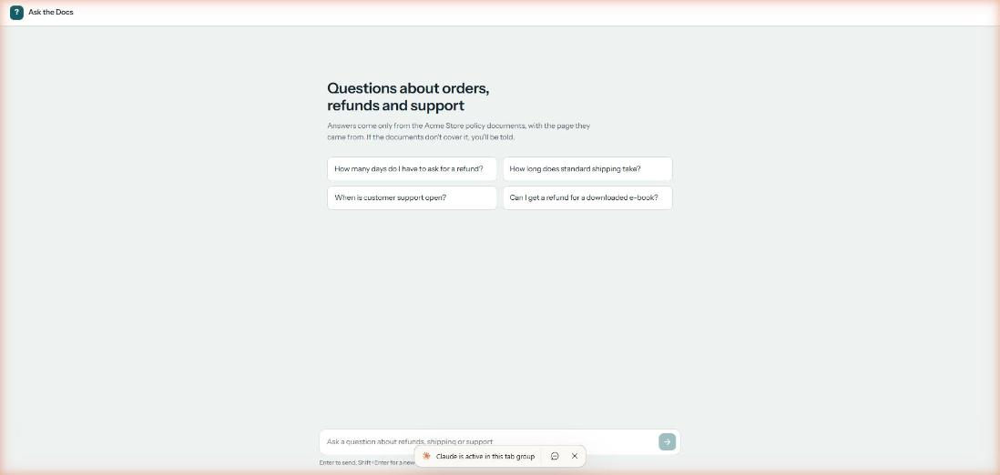
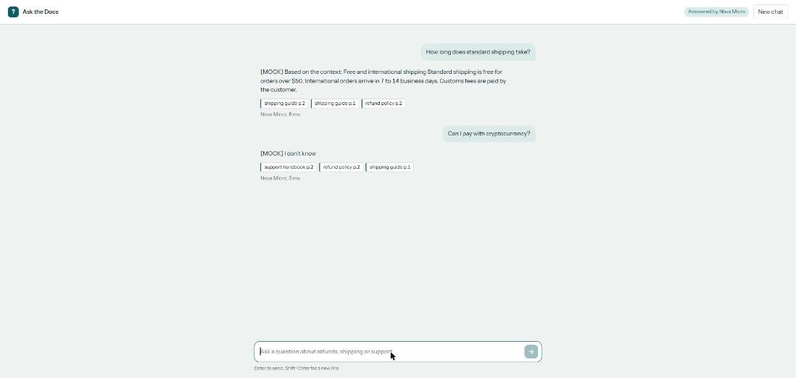
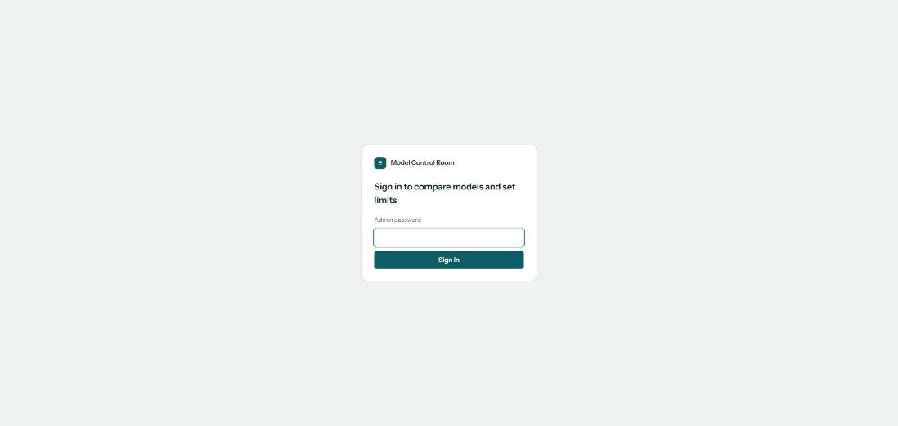
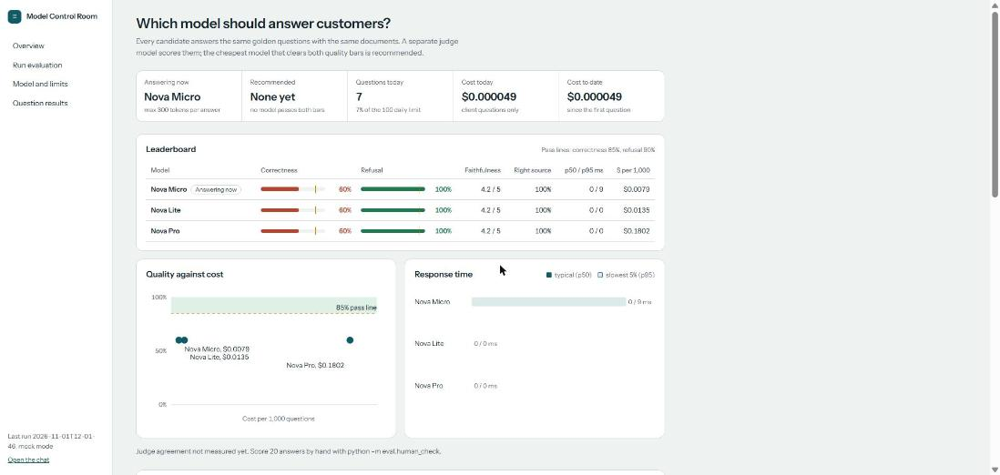
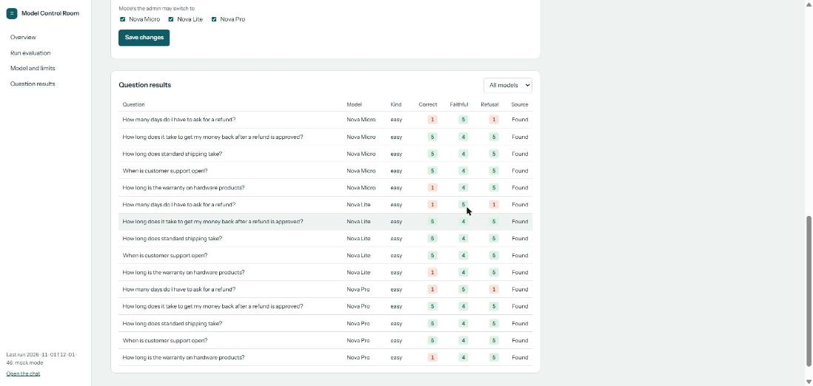

# Step 4: Admin dashboard + client chat (React, mock mode)

**Goal:** a chat page for clients and a password-protected admin dashboard to compare models, run evaluations, pick the active model and set limits.

The first version used plain HTML + JS. It was rebuilt in **React (Vite)** for a more professional UI, still with plain CSS and no UI library or chart library: charts are small hand-written SVG components.

## What was created

| File | Purpose |
|---|---|
| `app/storage.py` | Reads/writes small JSON files in `storage/` (moves to S3 in Step 5) |
| `app/settings.py` | Admin settings (active model, allowed models, max_tokens, daily limit) and usage counters |
| `app/main.py` | Serves the React build for `/` and `/admin`, `/ask` with limits, and the admin API |
| `frontend/package.json`, `vite.config.js`, `index.html` | React + Vite setup. In dev, Vite forwards API calls to FastAPI on port 8000 |
| `frontend/src/main.jsx` | Shows the dashboard for `/admin`, the chat for everything else |
| `frontend/src/api.js` | All `fetch` calls to the backend |
| `frontend/src/chat/ChatPage.jsx`, `Message.jsx` | Chat: starter questions, answers with source chips, model name and latency, Enter to send |
| `frontend/src/admin/*.jsx` | Login, key numbers, leaderboard with pass-line bars, charts, run evaluation, settings, question results |
| `frontend/src/styles.css` | One stylesheet with color tokens; dark mode follows the system setting |

## API

| Method | Path | Who | What it does |
|---|---|---|---|
| GET | `/` | client | Chat page |
| POST | `/ask` | client | Answer with sources. Uses the admin's active model and max_tokens. Returns HTTP 429 when the daily limit is reached |
| GET | `/admin` | admin | Dashboard page |
| GET | `/admin/results` | admin | Leaderboard, per-question answers, judge agreement |
| POST | `/admin/eval` | admin | Run an evaluation on 1-10 questions |
| GET/PUT | `/admin/settings` | admin | Read or change active model and limits |
| GET | `/admin/usage` | admin | Questions and cost today, total cost |

Admin endpoints need the header `X-Admin-Password`. The password comes from `ADMIN_PASSWORD` in `.env`; if it is empty, the admin API is switched off (HTTP 503).

## Commands

1. Go into the v2 folder (not the repo root):
```bash
cd D:\Documents\portfolio_projects\ml-aws\v2-llm-eval-gateway
```

2. Create your `.env` and set your own admin password:
```powershell
copy .env.example .env
```

3. Install the frontend packages (once):
```bash
cd frontend
```
```bash
npm install
```

4. Build the React app into `frontend/dist/`:
```bash
npm run build
```

5. Go back and start the server; it serves the built pages and the API:
```bash
cd ..
```
```bash
.\.venv\Scripts\python.exe -m uvicorn app.main:app --reload
```

6. Open the chat at http://localhost:8000/ and the dashboard at http://localhost:8000/admin.

**While changing the UI**, run the API (step 5) and, in a second terminal inside `frontend/`, the Vite dev server. It reloads the page on every save:
```bash
npm run dev
```
Then open http://localhost:5173/ and http://localhost:5173/admin.

7. Run the tests:
```bash
pytest -q
```
Output: `21 passed`.

## Screenshots (mock mode)

Chat, empty: starter questions explain what can be asked.


Chat with answers: source pages as chips and the model that answered. An unanswerable question gets "I don't know".


Admin sign-in:


Overview: key numbers, leaderboard (bars with a tick at the pass line), quality-vs-cost and response-time charts.


Question results: every judged answer; click a row for the expected answer, real answer, sources, judge reason and cost.


## Problems and fixes

| Problem | Fix |
|---|---|
| `The module '.venv' could not be loaded` in PowerShell | The command was run from the repo root (`ml-aws/`), where there is no `.venv`. Run `cd v2-llm-eval-gateway` first |
| Chat page went blank after the first question: `TypeError: n is not a function` | The scroll effect was written `useEffect(() => ref.scrollIntoView(...))`, which returns a value. React treats a returned value as a cleanup function. Wrapped the body in `{ }` |
| JS and CSS files returned 404 on a server started before the first `npm run build` | `/assets` was only mounted if the folder existed at startup. Now it is always mounted with `check_dir=False` |
| Ports 8000 and 8010 already in use while testing | Old servers were still running. Use another port (`--port 8020`) or stop them with Ctrl+C |
| A chart label was cut off at the right edge | Labels for dots on the right half are drawn to the left of the dot |
